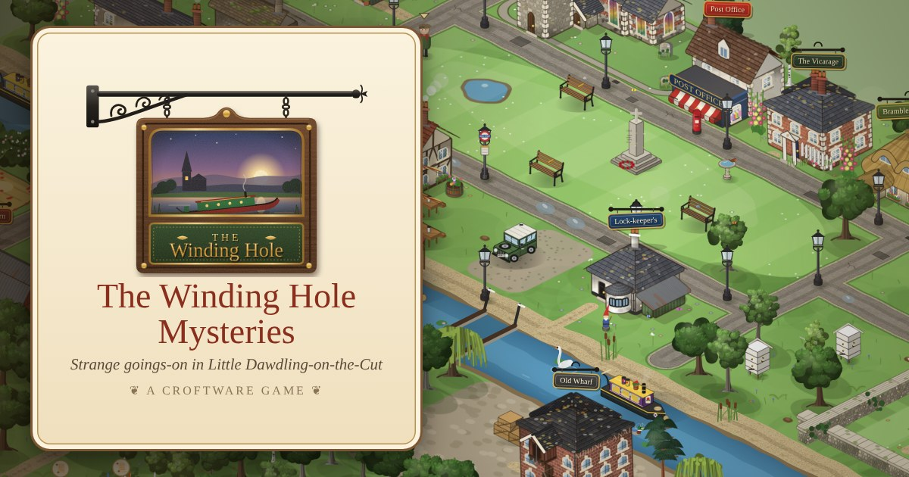
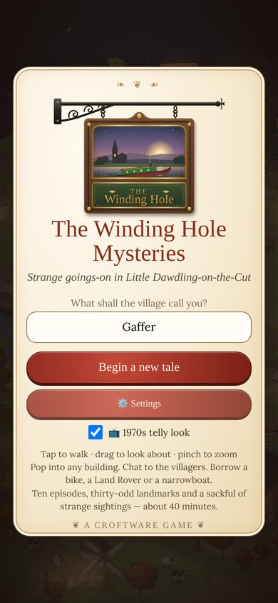
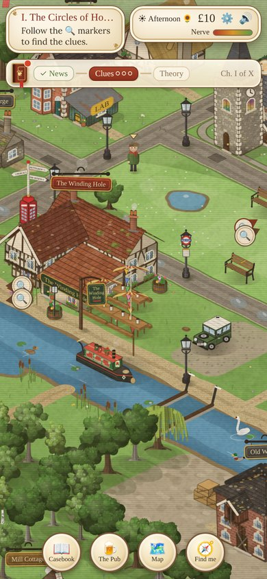
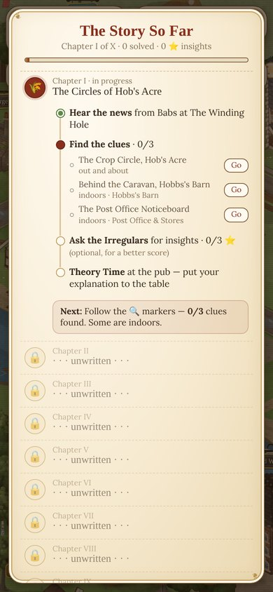

# The Winding Hole Mysteries

*Strange goings-on in Little Dawdling-on-the-Cut.*

A cosy folk-horror mystery game set in an English canal village with a 1970s-telly look. You and a handful of local oddballs, the Irregulars, look into ten strange cases. There are crop circles, lights over the old wharf, a beast in the woods and a poltergeist at the vicarage. Every mystery has a sensible explanation. Probably.

It plays in any modern web browser, on a phone, tablet or computer, with nothing to install.

  
  
  

## How to play

- **Tap** to walk, **drag** to look about and **pinch** to zoom.
- Each mystery follows four steps, shown on the ribbon at the top of the screen:
  1. **Hear the news** at The Winding Hole pub.
  2. **Find the three clues**: follow the 🔍 markers, outdoors and inside buildings.
  3. **Ask the Irregulars** (optional): each friend gives an insight ⭐ on the clue they know best.
  4. **Theory Time**: back at the pub, choose the explanation that fits the evidence.
- Tap the ribbon or the book icon to see **The Story So Far**, with a **Go** button for every step.
- Borrow a bike, Big Trev's Land Rover or Reg's narrowboat to get about.
- Night chapters drain your **Nerve**. Keep near the lamps and the pub.

## Features

- Ten chapters of mystery, about 40 minutes of play
- 34 ancient landmarks to record in the Antiquarian's Notebook
- 40-odd strange sightings to photograph for the Gazette
- Villagers to chat to and buildings to explore, inside and out
- Live time of day, seasons and weather, all adjustable in Settings
- An illustrated Storybook of your adventures, plus a spoiler-sealed walkthrough
- Occasional frights, if you dare (they can be switched off)
- Graphics settings from Simplest to Detailed, to suit any phone
- Progress is saved automatically on the player's own device

## Putting it on GitHub Pages

1. Create a new **public** repository on GitHub, for example `winding-hole`. Leave the README, .gitignore and licence options unticked, because they are already included here.
2. Upload everything in this folder to the repository and commit to the `main` branch.
3. Go to **Settings → Pages**. Under *Build and deployment* choose **Deploy from a branch**, then select `main` and `/ (root)`, and press **Save**.
4. After a minute or two the game is live at `https://<your-user>.github.io/winding-hole/`.

### Optional: your own address

To serve it from, say, `windinghole.croftware.com`:

1. In your DNS settings, add a **CNAME** record: `windinghole` → `<your-user>.github.io`.
2. In the repository, go to **Settings → Pages → Custom domain**, enter `windinghole.croftware.com`, save, and tick **Enforce HTTPS** once it becomes available. GitHub adds a `CNAME` file to the repository for you. Keep it.
3. For the best link previews, change the two `preview.jpg` image addresses near the top of `index.html` to the full web address, such as `https://windinghole.croftware.com/preview.jpg`.

## Files

| File | What it is |
|---|---|
| `index.html` | The whole game: code, artwork and music in one file |
| `icon.svg`, `favicon.ico` | Browser tab icons |
| `icon-192.png`, `icon-512.png`, `icon-maskable-512.png` | App icons for adding the game to a phone's home screen |
| `apple-touch-icon.png` | Home-screen icon for iPhone and iPad |
| `manifest.webmanifest` | Lets players install the game and play it full screen |
| `preview.jpg` | The picture shown when the link is shared |
| `screenshots/` | Pictures used in this README |
| `.nojekyll` | Tells GitHub Pages to serve the files as they are |
| `LICENSE` | Terms of use |

The only things the game loads from the internet are its fonts from Google Fonts. If they can't be reached, it falls back to Georgia.

## Credits

Written and designed by **Croftware** (Nathan Brown).
Enquiries: [nathan@croftware.com](mailto:nathan@croftware.com) · [croftware.com](https://www.croftware.com)

© 2026 Croftware. All rights reserved.

## Licence

Free to play for personal, non-commercial use. Copying, modifying, redistributing or commercial use is not permitted without written permission. See [LICENSE](LICENSE) for details.
